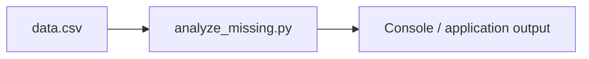

# Architecture — Intelligent Missing Data Analyzer

## Inputs

- `sample/data.csv`

## Source files

- `src/analyze_missing.py`

## Output

This representation is intended for source navigation. It does not imply a production deployment or undisclosed components. The editable diagram is available as [`architecture.mmd`](architecture.mmd).
